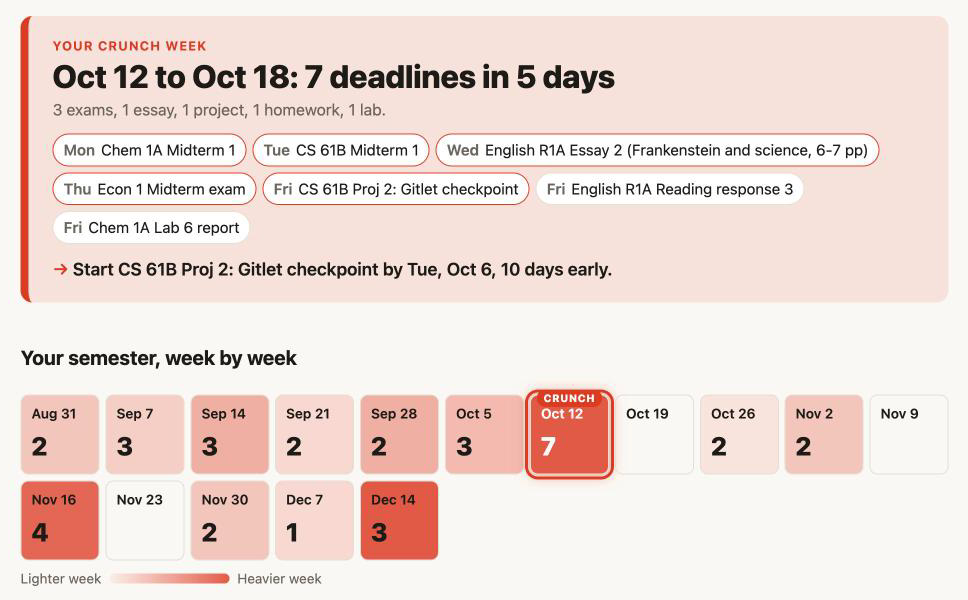

# Crunch Week

Paste your syllabi, see your crunch weeks coming, and find your textbooks free.



**Live:** https://hayobro7512.github.io/crunch-week/ · **Video:** link added at submission

## What it does
Every student has four or five syllabi, thirty-some deadlines, and finds out it's midterm week on the Monday it starts. Paste your syllabi (or click "Load sample") and Crunch Week pulls out every deadline, lays the semester out as a week-by-week heatmap, and calls out your worst week with a "start by" nudge for its biggest item. It also finds the required texts in each syllabus and checks Open Library live for a free copy: free to read, free to borrow, or an older edition that's free. One click exports every deadline to your calendar as an .ics file.

## Run it
It's a static site with no build step and no keys. Serve the folder with any static server:
```
python3 -m http.server 8000   # then open http://localhost:8000
```
Checks: `node test/check.mjs --live` (texts, Open Library, .ics) and `node test/parse.mjs` (needs `npm install --no-save chrono-node@2.7.7`).

## How it's built
Plain HTML, CSS and JavaScript ES modules, deployed to GitHub Pages by a GitHub Action.
- `src/parse.js` turns syllabus text into dated items with [chrono-node](https://github.com/wanasit/chrono) 2.7.7 (loaded from jsDelivr through an import map). It also handles table rows, date ranges, dotted dates and "Week N" schedules counted from the first day of class. It uses each syllabus's "Fall 2026" header to put every date in the right year.
- `src/crunch.js` buckets items into Monday-to-Sunday weeks and scores each week by weight (exam 5, project 4, essay 3, lab and quiz 2, homework 1). The heatmap uses a fixed scale, where 3 exams' worth of work is full red, so a calm semester looks calm.
- `src/books.js` finds the required-texts list in each syllabus ("Required texts:", "Required:", "Textbook:", plus "Recommended:" and "free alternative:" picks). It calls the free, keyless [Open Library search API](https://openlibrary.org/dev/docs/api/search) straight from the browser, one request per book in parallel with a 6 s timeout, and searches by ISBN first when the syllabus gives one. `ebook_access` drives the badges ("Free to read", "Free to borrow", "Older edition free", "No free copy") and the free count. If Open Library is down, the panel says so and the rest of the page keeps working.
- `src/ics.js` writes an RFC 5545 calendar: one all-day event per deadline, CRLF line endings, long lines folded at 75 bytes.
- `judge/` holds the messy syllabi we tested against. `test/` turns them into checks.

## Built at Campus Tools Mini-Hack
Everything here was built during the event, Nov 12, 2026, 21:00 to Nov 13, 02:00 Pacific. Pre-existing pieces: the open-source chrono-node library and the public Open Library API. The sample syllabi are invented for the demo.
